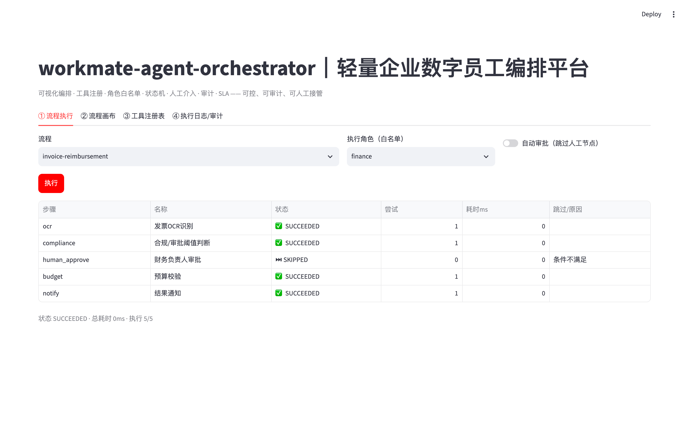
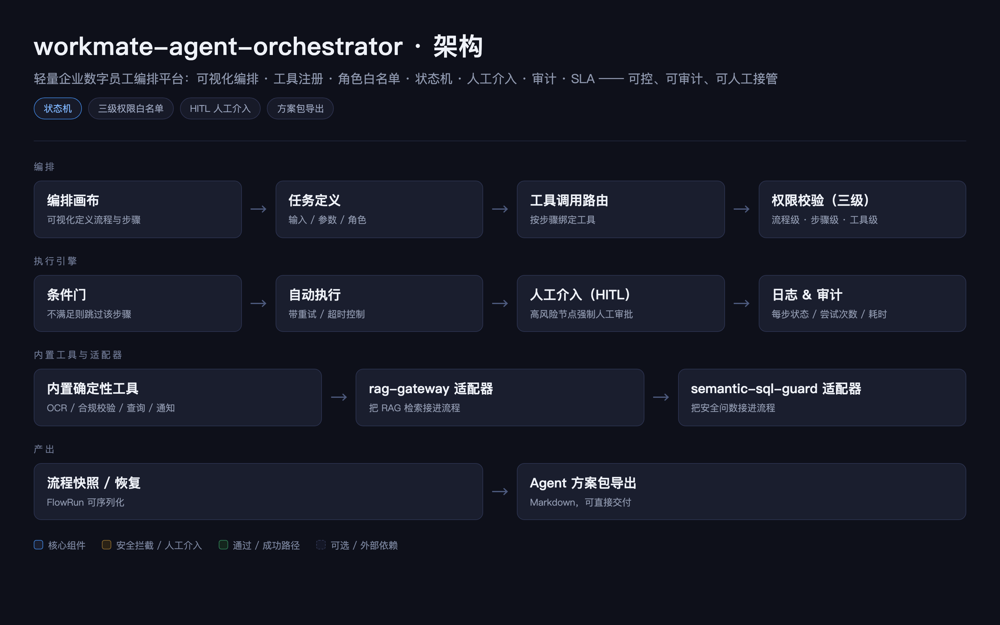
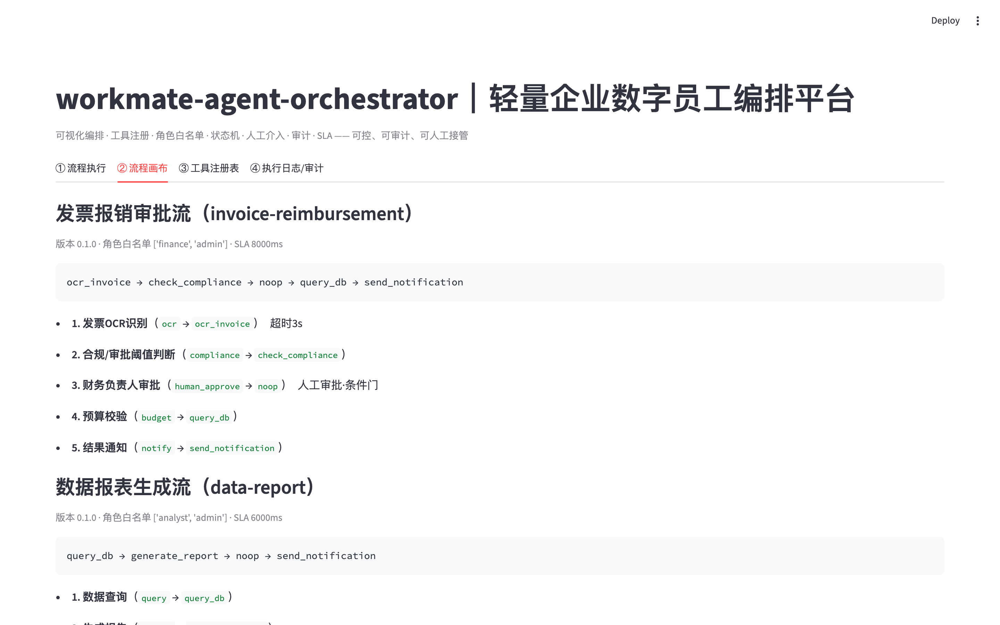
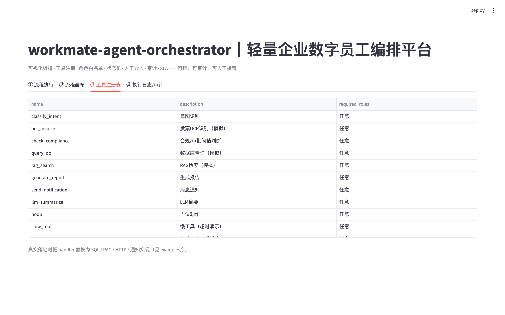
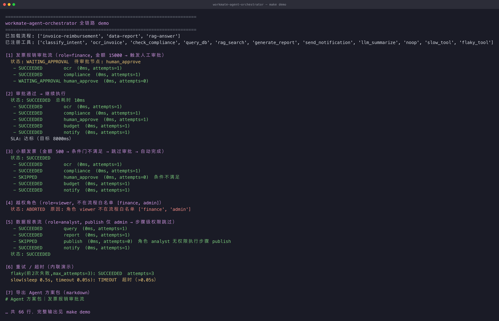

# workmate-agent-orchestrator

[](https://www.python.org/) [](#license) []() []() [](https://github.com/fenrir1111/workmate-agent-orchestrator/actions/workflows/ci.yml)

> 轻量企业数字员工编排平台｜面向 B 端 POC 的 Agent 可视化编排，权限隔离、人工介入、审计闭环

> 属于【enterprise-ai-stack】B端私有化 AI 交付底座合集
> 👉 总入口：https://github.com/fenrir1111/enterprise-ai-stack

## 🚀 运行效果（真实截图）

选流程 `invoice-reimbursement`、角色 `finance`，点「执行」→ 每步状态、尝试次数、跳过原因全部可见（越权角色直接 `ABORTED`）：



## 🎬 一条命令跑通（真实终端录制）

`make demo` 一条命令跑通全链路（**真实终端录制**，非模拟）：人工审批介入 → 条件门跳过 → 越权中止 → 步骤级权限 → 重试/超时：


## 一句话简介
轻量级 Agent 编排底座，面向交付团队快速搭建企业数字员工 POC；**不做花哨多智能体**，
优先保证**可控、可审计、可人工接管**，对接知识库、SQL 查询、审批单据等企业工具。
设计原则：**确定性流程自动化，高风险节点强制人工介入、留痕审计**。

## 适用场景
内部数字员工、单据自动核查、安全生产巡检、纪检资金分析、报表自动生成等 POC 验证。

## 核心能力
1. **可视化流程画布**编排任务节点（JSON 定义，低代码）。
2. **工具注册中心**：SQL 工具、RAG 查询、HTTP 接口、通知工具，统一按名路由。
3. **角色权限隔离**：流级 / 步骤级 / 工具级 三级白名单，每个 Agent 只调白名单内工具。
4. **状态机驱动**：失败重试、超时控制、条件分支、**人工介入（HITL）审批/驳回**。
5. **全链路执行日志、SLA 告警、任务快照**（可挂起 / 跨进程恢复）。
6. **导出 Agent 方案包**（JSON / Markdown），直接交付客户 POC。

## 架构简图



<details>
<summary>文本版架构简图</summary>

```
编排画布 → 任务定义 → 工具调用路由 → 权限校验(三级) → 执行分支(自动/人工) → 日志&审计
                                   │
              ┌────────────────────┼────────────────────┐
        内置确定性工具        rag-gateway 适配器     semantic-sql-guard 适配器
```

</details>


## 快速启动
### 方式一：uv（推荐，本地）
```bash
uv venv .venv
uv pip install --python .venv/bin/python -r requirements.txt
uv pip install --python .venv/bin/python -e .

# 跑全链路 demo（工具路由+权限+状态机+重试/超时+人工介入+SLA+方案包，无需起服务）
.venv/bin/python -m agent_orchestrator.demo

# 起服务
.venv/bin/python -m uvicorn agent_orchestrator.main:app --host 0.0.0.0 --port 8000
# 交互式文档: http://127.0.0.1:8000/docs
```
或用 `make` 快捷命令：`make demo` / `make run` / `make test` / `make ui`。

### 方式二：Docker
```bash
docker compose up -d --build
curl http://127.0.0.1:8000/health
```

### 调用示例
```bash
# 触发发票报销审批流（finance，金额 15000 → 超阈值 → 停在人工审批）
curl -s localhost:8000/run -H 'Content-Type: application/json' \
  -d '{"flow_id":"invoice-reimbursement","role":"finance","inputs":{"file":"invoice_15000.00.pdf","applicant":"zhangsan"}}'
# → 返回 report，status=WAITING_APPROVAL，拿到 run_id

# 审批通过 → 续跑完成
curl -s localhost:8000/approve -H 'Content-Type: application/json' \
  -d '{"run_id":"<run_id>","approver":"finance-lead"}'

# 导出 Agent 方案包（markdown）
curl -s localhost:8000/export-plan -H 'Content-Type: application/json' \
  -d '{"run_id":"<run_id>","fmt":"markdown"}'
```

## 真实运行效果（`make demo` 真实输出，节选）

> 想看**动画版**（真实终端逐行录制）见文首「🎬 一条命令跑通」。

```text
[发票报销 金额=15000, role=finance] → WAITING_APPROVAL（高风险节点强制人工介入）
  ocr → compliance → [WAITING_APPROVAL] human_approve
  approve → SUCCEEDED（5 步全过，SLA 达标 8000ms）

[发票报销 金额=500] → SUCCEEDED
  ocr → compliance → [SKIPPED 条件不满足] human_approve → budget → notify   ← 小额自动过

[role=viewer] → ABORTED：不在流程白名单 [finance, admin]   ← 流程级越权
[flaky 工具]  → SUCCEEDED attempts=3                         ← 自动重试
[slow 工具]   → TIMEOUT（>0.05s，非阻塞）                    ← 超时控制
```
**可控、可审计、可人工接管**：状态机 + 三级权限白名单 + HITL 审批 + 重试/超时。

## 系统实拍（真实运行截图）

以下截图均为**本仓库真实运行**产出（`make ui` 起控制台 + `make demo` 跑全链路），未经修饰。

### 1. 流程执行 · 每步状态可见

选流程 `invoice-reimbursement`、角色 `finance`，点「执行」——每一步的状态、尝试次数、耗时、跳过原因全部列出（见文首「🚀 运行效果」）：

### 2. 流程画布 · 步骤与工具链路



### 3. 工具注册表 · 真实落地替换点

工具清单、参数与说明一目了然，落地时把 handler 换成 SQL / RAG / HTTP / 通知实现即可：



### 4. `make demo` 终端输出

```text
[1] 发票报销审批流（role=finance, 金额 15000 → 触发人工审批）
  状态: WAITING_APPROVAL  待审批节点: human_approve
[4] 越权角色（role=viewer, 不在流程白名单 [finance, admin]）
  状态: ABORTED  原因: 角色 viewer 不在流程白名单 ['finance', 'admin']
```



## 核心接口
| 方法 | 路径 | 说明 |
|---|---|---|
| POST | `/run` | 执行流程（带角色 + 输入，可选 `auto_approve`） |
| POST | `/approve` | 审批通过人工节点（续跑） |
| POST | `/reject` | 驳回人工节点（中止） |
| POST | `/snapshot` | 导出任务快照（可恢复） |
| POST | `/export-plan` | 导出 Agent 方案包（`json` / `markdown`） |
| GET | `/runs/{run_id}` | 任务状态 |
| GET | `/runs/{run_id}/report` | 执行报告（执行日志） |
| GET | `/flows` | 流程列表 |
| GET | `/tools` | 工具注册表 |
| GET | `/health` | 健康检查 |

## 接入你的真实系统
- **对接 RAG / SQL 底座**：把 `enterprise-rag-gateway`、`semantic-sql-guard` 封装成工具
  注册进 `ToolRegistry`，流程步骤用 `tool` 名称调用，示例见
  [`examples/rag_gateway_adapter.py`](examples/rag_gateway_adapter.py) 与
  [`examples/sql_guard_adapter.py`](examples/sql_guard_adapter.py)。
- **接真实 LLM / 消息通知**：把内置工具的 handler 替换为真实实现（LiteLLM / 飞书 / 钉钉）。
- **多实例高可用**：外置 `FlowRun` 状态（DB/Redis），基于快照恢复。

## CI 与质量门禁

每次 push / PR 自动跑 [GitHub Actions](https://github.com/fenrir1111/workmate-agent-orchestrator/actions/workflows/ci.yml)（Python 3.10 + 3.12 双版本矩阵）：

| 环节 | 检查内容 |
|---|---|
| 单元测试 | `pytest` 全量（含 Streamlit 控制台冒烟，捕获脚本被当独立模块执行时的 ImportError） |
| demo 冒烟 | `python -m agent_orchestrator.demo` 全链路跑通，退出码必须为 0 |
| FastAPI 冒烟 | 起 `uvicorn` 并请求 `/health`，30s 内未就绪即失败 |
| Streamlit 冒烟 | 起控制台并请求 `/_stcore/health`，30s 内未就绪即失败 |

> 其中 `tests/test_streamlit_app.py` 用 Streamlit 官方 `AppTest` **真正执行一遍页面脚本**：
> Streamlit 是把 `streamlit_app.py` 当独立脚本跑的（没有 `__package__`），
> 一旦脚本里用了相对导入就会直接 `ImportError`，但页面仍返回 HTTP 200 —— 只有真跑一遍才发现得了。

本地复现：

```bash
make test    # 单元测试 + 控制台冒烟
make demo    # 全链路 demo
```

## 设计原则
- **可控优先**：节点顺序与分支由画布定义，模型只影响"工具产出"，不自主改路径。
- **权限前置**：三级白名单在执行前判定，越权节点直接跳过/拦截，而非事后过滤。
- **确定性可复现**：默认内置确定性工具，离线可跑、可单测、可复现；真实工具为可选增强。
- **叠加不替代**：依赖企业 IAM 同步角色，只做白名单判定，不替代等保体系。

## 已知局限（非常重要）
1. 面向**可控流程编排**，不做通用自主规划 Agent（不支持开放长链路自我规划）。
2. 人工节点需对接企业消息通知系统（飞书 / 钉钉）推送审批人。
3. 运行态为**单进程内存态**，多实例高可用需外置状态存储。
4. 内置工具为确定性模拟，生产需替换真实实现或接 examples 适配器。
5. 超时为线程池模拟（非强杀），长耗时外部调用需业务侧兜底。

> 详见 [`docs/limitation.md`](docs/limitation.md)。

## 迭代计划
- v0.1：画布编排、工具注册、人工节点、审计日志
- v0.2：SLA、重试策略、告警
- v0.3：对接 eval-harness 评估 Agent 成功率
- v0.4：POC 模板市场、方案包共享

## 适合人群
数字员工、AIBP、Agent 交付 FDE，快速验证客户流程自动化需求。

## 参与共建
欢迎提交 Issue（反馈 bug、补充流程模板）、PR（适配真实工具、并行分支、状态外置）。
有效贡献在 README 致谢栏署名。
详细流程见 [CONTRIBUTING.md](CONTRIBUTING.md)。

## License
MIT License，可自由使用、二次修改、商用；当前为 v0 版本，生产使用请自行评估风险。
