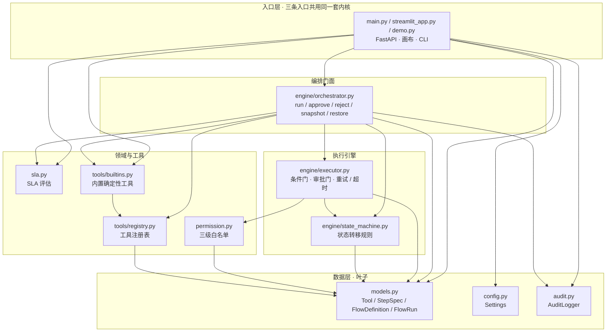

# 架构说明

## 分层
```
┌────────────────────────────────────────────────────────────────┐
│  接入层   main.py (FastAPI)  /  streamlit_app.py (画布/执行)      │
├────────────────────────────────────────────────────────────────┤
│  编排门面  engine/orchestrator.py                                │
│          run / approve / reject / snapshot / restore / export    │
├────────────────────────────────────────────────────────────────┤
│  执行引擎  engine/executor.py + engine/state_machine.py          │
│   参数模板渲染 → 条件门 → 人工审批门 → 工具调用(重试/超时) → 结果   │
├────────────────────────────────────────────────────────────────┤
│  领域     models.py (Tool/StepSpec/FlowDefinition/FlowRun)       │
│          permission.py (三级白名单)  sla.py  audit.py            │
├────────────────────────────────────────────────────────────────┤
│  工具注册  tools/registry.py + tools/builtins.py                │
│          （examples/ 提供 rag-gateway / sql-guard HTTP 适配器）   │
└────────────────────────────────────────────────────────────────┘
```

## 执行主链路（状态机驱动）
```
FlowRun(PENDING)
  → 流级白名单校验 ── 不通过 → ABORTED
  → RUNNING → 逐节点执行：
       ① 步骤级白名单（不通过 → SKIPPED）
       ② 条件门 {prev,field,op,value}（不满足 → SKIPPED）
       ③ 人工审批门（requires_approval 且未审批 → WAITING_APPROVAL 挂起）
       ④ 工具级白名单（不通过 → FAILED）
       ⑤ 渲染参数 → 调用工具（max_attempts 重试 + timeout 超时）
          成功 → SUCCEEDED ；失败 on_failure=fail → 流程 FAILED
  → 全部节点完成 → SUCCEEDED（记录总耗时 / SLA）
```

## 模块依赖图

按**真实 import 关系**绘制（箭头 = 依赖方向，`A → B` 表示 A import B）。增删模块时请同步更新本节。



> `engine/__init__.py` / `tools/__init__.py` 只做 re-export，`examples/` 下的 rag-gateway / sql-guard HTTP 适配器属于仓库外接入示例，均不在图内。

### 依赖不变量（改动时一并守住）

1. **`executor.py` 依赖 `permission.py`，而 `permission.py` 只依赖 `models.py`**：三级白名单判定是纯函数、不依赖执行引擎，因此工具调用无法绕过权限判定。
2. **`state_machine.py` 只依赖 `models.py`**：状态转移是纯规则，`executor` 与 `orchestrator` 都只能通过它推进状态，避免 `WAITING_APPROVAL` 挂起态被旁路改写（挂起可快照、跨进程恢复）。
3. **`tools/builtins.py` 只依赖 `tools/registry.py`**：内置确定性工具与编排层解耦；接真实 RAG / SQL 服务走 `examples/` 适配器，不改引擎。
4. **`audit.py` / `config.py` / `models.py` 是叶子**，无框架依赖；LLM 不是必需节点，离线可跑通全链路、可单测。
5. **`streamlit_app.py` 是唯一使用绝对导入的模块**（`sys.path` 自举）；整图 DAG 无环，37 个 pytest 不需要起服务、不需要外网。

### 扩展点

新增工具只需在 `tools/registry.py` 注册并实现函数；`examples/rag_gateway_adapter.py` / `examples/sql_guard_adapter.py` 是接真实底座的范例。高风险节点用 `requires_approval` 声明即可挂起等人签字，不需要改状态机或执行器。

## 关键设计
- **三级权限白名单**：流级（谁能启动）、步骤级（谁能执行某节点，如"仅 admin 可发布"）、
  工具级（高危工具要求特定角色）。空白名单 = 任意放行。依赖外部 IAM 同步角色，本层只做判定。
- **人工介入（HITL）**：`requires_approval` 节点在条件满足时挂起为 `WAITING_APPROVAL`，
  外部审批人调用 `approve`（续跑）或 `reject`（中止）。挂起态可**快照落盘**、跨进程恢复。
- **可复现 / 离线**：默认内置确定性工具（`builtins`），无需真实 SQL/RAG/LLM 即可跑通、可单测。
- **方案包导出**：一次运行可导出 JSON / Markdown 方案包（流程定义 + 执行结果 + SLA + 权限），
  直接作为 POC 交付物。

## 与合集中其它底座的关系
- `enterprise-rag-gateway`：作为 `rag_gateway` 工具（见 examples/rag_gateway_adapter.py）。
- `semantic-sql-guard`：作为 `sql_guard` 工具（见 examples/sql_guard_adapter.py）。
- `enterprise-ai-eval-harness`：v0.3 对接，评估 Agent 流程执行成功率。
